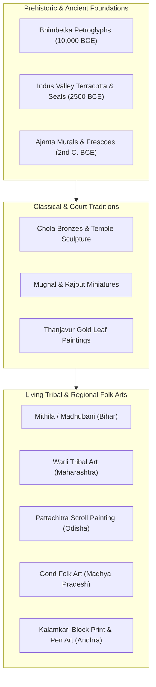

<div align="center">

# 🎨 Kalākrama (KalaBhumi)

**Interactive Digital Heritage, Chronological Timeline & Regional Taxonomy of Indian Traditional Art**

[](https://developer.mozilla.org/en-US/docs/Web/HTML)
[](https://developer.mozilla.org/en-US/docs/Web/CSS)
[](https://developer.mozilla.org/en-US/docs/Web/JavaScript)
[](https://fonts.google.com/)
[](LICENSE)

</div>

---

## 🌟 Executive Summary

**Kalākrama (KalaBhumi)** is a digital humanities curation and interactive web portal dedicated to preserving and celebrating traditional Indian art forms. Spanning millennia of cultural evolution—from prehistoric rock shelters to classical court miniatures and indigenous tribal expressions—Kalākrama presents an accessible, chronologically indexed timeline accompanied by high-resolution visual analysis and regional geographical mappings.

---

## 🏛️ Cultural & Art Traditions Featured



---

## ✨ Key Capabilities

- **Fluid Chronological Timeline:** Seamlessly navigate between major epochs of Indian artistic history with smooth hardware-accelerated transitions.
- **Bespoke Heritage Design System:** Tailored dark-paper palette (`#0e1016` background with `#d9b36a` gold accents), radial ambient glows, and paired Devanagari typography (`Rozha One` display and `Work Sans` body).
- **Interactive Art Gallery & Modal Inspector:** High-definition inspection of stylistic motifs, natural pigment techniques (indigo, lampblack, ochre, vermilion), and regional materials.
- **Zero-Dependency Architecture:** Pure semantic HTML5, modern CSS3 variables, and vanilla ES6 JavaScript—instant loading with zero build steps or npm baggage.

---

## 📂 Repository Structure

```
indianartformharinish-1/
├── index.html                  # Main interactive timeline & portal experience (Kalākrama)
├── kalabhumi.html              # Comprehensive regional folk art directory & showcase
├── AGENTS.md                   # AI pair-programming & design tokens guide
├── PRD.md                      # Product Requirements Document
├── TODO.md                     # Actionable engineering tasks
└── LICENSE                     # MIT License
```

---

## 🚀 Quick Start

No package manager or build pipeline required!

### Option 1: Direct Browser Launch
Simply double-click `index.html` or open it in any modern web browser:
```bash
start index.html # On Windows
```

### Option 2: Local HTTP Server
```bash
npx serve .
# Or using Python:
python -m http.server 8000
```
Open [http://localhost:8000](http://localhost:8000) in your browser.

---

## 📄 License

Distributed under the MIT License. See [`LICENSE`](LICENSE) for details.
